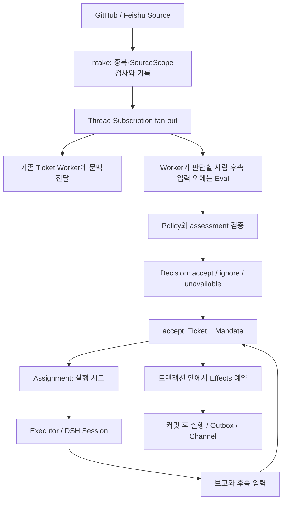

# 공개 Super-agent 프로토타입 분석

이 문서는 `deepseek-ai/dsh-superagent-prototype`의 설계와 구현을 찾아보는 한국어 참조 자료입니다. Python 함수·상태 그래프·트랜잭션의 기초를 전제로 합니다. 실행하면서 배우려면 [09 권한 판단](notebooks/09_prototype_admission.ipynb) → [10 작업 수명주기](notebooks/10_prototype_ticket_lifecycle.ipynb) → [11 영속 Effects](notebooks/11_prototype_durable_effects.ipynb) 순서로 진행하세요.

## 1. 이 저장소에서 배울 핵심

프로토타입은 **외부 사건을 지속적으로 받아, 실행할 권한이 있는 일을 식별하고, 작업과 실행 시도를 별도로 관리하는 시스템**입니다. 모델의 답변 품질 외에도 “왜 시작했는가, 누구의 권한인가, 후속 사건을 누가 판단하는가, 장애 후 무엇을 다시 해야 하는가”를 도메인 데이터로 다룹니다. 사람의 개입을 줄이려면 자율 실행 능력과 함께 실행하지 않을 조건, 중단의 의미, 추적 가능한 상태가 필요하다는 설계입니다.

[README](https://github.com/deepseek-ai/dsh-superagent-prototype/blob/8c32a9dc5d72c033816c6a8110b37f40cf94fba4/README.md)는 연구 참고용이며 공식 제품이 아니고, 공개 과정에서 조정되어 내부 버전 및 연구 글과 동일하지 않으며, 제안된 설계 일부는 구현되지 않았다고 명시합니다. 따라서 연구 글의 모든 특성을 이 코드의 기능으로 해석하면 안 됩니다. 아래 설명은 클라우드에서 복제한 특정 revision의 문서·코드·테스트를 근거로 합니다. 정확한 revision, 파일 해시, 검증 결과는 [수집 근거](sources/prototype-evidence.json)에 보존했습니다. 구현 근거 링크는 분석한 revision으로 고정했습니다.

|대상|역할|이 교재에서 읽는 방법|
|---|---|---|
|Super-agent 연구 글|지속적·능동적 에이전트의 목표와 설계 제안|00–08에서 개념과 트레이드오프 실험|
|DeepSeek Harness|Cordis 플러그인 기반 실행 기반|plugin lifecycle, 세션·도구·로그의 기반|
|이 프로토타입|하나의 GitHub 저장소를 대상으로 하는 DSH bundle, 선택적 Feishu 연동|아래의 업무 도메인, 승인, 영속 실행 구조 분석|
|Python 실습|일부 불변조건을 LangGraph와 SQLite로 재현|공식 SDK 호환성이나 모델 판단 품질 검증은 아님|

일반적인 `사용자 입력 → 모델 → 도구 → 답변` 루프에 비해 이 구현은 사건 수집, 업무 권한, 작업 수명, 전달 재시도에 더 많은 책임을 둡니다. 이러한 기능은 다른 프레임워크로도 구현할 수 있습니다. LangGraph의 체크포인트는 유용한 실행 상태 저장 수단이지만, 어떤 사건이 어떤 업무를 승인하는지와 외부 전송의 중복 처리는 애플리케이션이 정의해야 합니다.

## 2. 전체 흐름과 코드의 배치

`src/core`는 도메인 상태 전이를 소유하며 저장소·정책·실행기 포트를 사용합니다. `src/app`은 SQLite, 세션, 도구, Effects, HTTP와 런타임을 조립합니다. `src/sources`는 GitHub/Feishu 사건과 채널을 변환하고, `src/executor`는 실제 작업 실행을 연결합니다. `src/client`는 사람에게 상태와 설정을 보여 줍니다. [아키텍처 문서](https://github.com/deepseek-ai/dsh-superagent-prototype/blob/8c32a9dc5d72c033816c6a8110b37f40cf94fba4/docs/007-architecture.md)와 [Runtime](https://github.com/deepseek-ai/dsh-superagent-prototype/blob/8c32a9dc5d72c033816c6a8110b37f40cf94fba4/src/app/runtime.ts)이 조립 관계의 출발점입니다.

|개념|의미|혼동하면 생기는 문제|
|---|---|---|
|Trigger|외부에서 들어온 불변 사건|같은 사건을 새 요청으로 처리해 중복 작업 생성|
|Thread|대화 흐름. Trigger 하나가 여러 Thread에 속할 수 있음|대화 하나가 작업 하나라는 잘못된 가정|
|Correlation|관련 Thread를 찾아보는 문맥 연결|관련성만으로 입력을 전달하거나 권한 부여|
|Subscription|Ticket이 어떤 Thread의 입력을 받는지|문맥 수신을 실행 승인으로 해석|
|Eval / Decision|후보의 평가 시도와 그 결과|지연된 모델 결과를 현재 정책의 승인으로 사용|
|Mandate|승인 당시의 범위·강도·행위자·정책과 근거|새 댓글이 작업 범위를 자동 확대|
|Ticket|승인된 일의 지속적 정체성|세션 종료와 업무 종료를 동일시|
|Assignment|Ticket의 개별 실행 시도|이전 시도의 늦은 보고가 현재 상태를 덮어씀|
|Effects / Outbox|외부 실행·전달을 위한 영속 예약|상태 저장과 외부 I/O 사이 장애로 유실·중복|

## 3. 권한과 문맥을 분리한다

[정책 코드](https://github.com/deepseek-ai/dsh-superagent-prototype/blob/8c32a9dc5d72c033816c6a8110b37f40cf94fba4/src/policy.ts)에는 두 단계가 있습니다. 먼저 Source별 actor와 admission 설정으로 `explicit`, `inferred`, `ignore`를 정합니다. explicit은 직접 요청 등 명시적 권한 경로이며, inferred는 규칙 평가가 필요한 후보입니다. 사람의 계정을 서로 다른 Source 사이에서 자동으로 같은 사람으로 합치지 않습니다. 허용 목록에 없는 사람도 admission 설정에 따라 취급이 달라지므로 “allowlist 하나가 모든 입력을 차단한다”라고 요약할 수 없습니다.

inferred 승인에는 활성 규칙 각각에 대한 평가가 정확히 한 번씩 필요하고, 하나 이상이 일치해야 합니다. 또한 구현 요청이어야 하며 목표가 지정되었거나 기존 기준으로 확정되고, 추가 디자인 결정이 필요하지 않으며, 요청 의도 근거가 있어야 합니다. 기본 `copy`와 `visual` 규칙은 오탈자와 국소적 시각 수정에 초점을 둡니다. “보기 이상하다”가 곧 재설계 승인인 것은 아닙니다. 이 평가 요건을 모든 explicit 경로에 그대로 적용해서 설명하면 부정확합니다.

|설정·상황|inferred 후보에 대한 의미|
|---|---|
|`off`|능동적 후보 수락을 끔|
|`observe`|실행 가능한 판단도 `would_accept`로 기록하고 Worker를 시작하지 않음|
|`auto`|다른 조건을 충족한 후보를 수락할 수 있음|
|평가 중 policyVersion 변경|이전 정책으로 만든 판단은 유효한 승인으로 사용할 수 없음|

`policyVersion`은 권한에 영향을 주는 규칙·모드·Source 정책으로 계산합니다. 모델·동시 실행 수·일시 정지 등의 모든 설정 변경을 묶은 전체 revision과는 다릅니다. 진행 중 Ticket에는 정책 변경을 전달하며, 종료된 Ticket을 재개할 때는 현재 정책으로 Mandate를 재검증합니다. 사람의 stop은 Mandate 철회로 취급합니다. 범위의 자연어 의미를 지키는 데에는 Worker 프롬프트도 참여하므로 모든 범위 제한이 OS 수준으로 강제된다고 볼 수 없습니다.

**실습 연결:** [09](notebooks/09_prototype_admission.ipynb)는 고정 모델 판단 뒤에 LangGraph의 결정적 검증 노드를 두고 observe, 정책 변경, 불명확한 방향, 근거 누락을 비교합니다.

## 4. 후속 사건의 소유자를 먼저 정한다

[Intake](https://github.com/deepseek-ai/dsh-superagent-prototype/blob/8c32a9dc5d72c033816c6a8110b37f40cf94fba4/src/core/intake.ts)는 SourceScope 확인 뒤 구독을 따라 입력을 전달하고, 누가 사람의 후속 입력을 판단하는지 확인해 Eval 여부를 결정합니다. 기존 02 노트북의 단순한 “semantic filter → routing” 순서와 다릅니다. 수신 문맥에는 허용 목록 밖 작성자의 댓글도 포함될 수 있지만, 문맥 수신은 새 업무를 수행할 권한을 만들지 않습니다.

|사건|기존 Ticket 전달·재개|별도 Eval|
|---|---|---|
|진행 중 Ticket의 소유 Thread에 사람 후속 입력|전달; Worker가 후속 입력을 판단|해당 Worker가 소유하면 생략|
|진행 중 Ticket의 bot/CI 입력|구독 문맥으로 전달 가능|독립적으로 평가 대상|
|context-only Thread의 사람 입력|살아 있는 Ticket에 참고 문맥 전달|소유 후속 입력이 아니므로 평가 대상|
|Executor가 종료한 Ticket의 소유 Thread에 사람 입력|현재 정책 재검증 등 재개 조건을 충족하면 새 시도로 재개|소유권·재개 결과에 따라 처리|
|사람이 stop한 Ticket에 새 입력|그 Ticket에는 전달·자동 재개하지 않음|다른 작업 후보로 평가될 수 있음|

Eval로 간다는 것은 무조건 Worker를 만든다는 뜻이 아닙니다. 이후 정책 검사에서 거절될 수 있습니다. Correlation만으로 라우팅하지 않고 Subscription을 사용하며, 여러 Thread를 거쳐 같은 Ticket에 도달하면 `reached` Map으로 합쳐 중복 전달을 막습니다.

Thread별 활성 Eval을 제한하고 후속 사건을 묶습니다. 평가 제한 시간은 큐에 넣은 때가 아니라 세션에 실제 전달한 시점부터 계산하며, pause 시간을 고려합니다. 재시도 한도를 넘긴 평가를 끝없이 기다리지 않고 unavailable로 기록합니다. 관련 구현은 [Evals](https://github.com/deepseek-ai/dsh-superagent-prototype/blob/8c32a9dc5d72c033816c6a8110b37f40cf94fba4/src/core/evals.ts)에 있습니다.

## 5. Ticket과 Assignment를 분리한다

Ticket의 승인 범위는 유지한 채 실행 시도는 교체할 수 있습니다. 예를 들어 첫 Assignment가 종료된 뒤 사람이 범위 내 후속 요청을 보내면 재검증 후 다음 Assignment가 생길 수 있습니다. 이때 첫 Assignment의 늦은 결과를 현재 시도의 보고로 받아들이면 안 됩니다. [Assignments](https://github.com/deepseek-ai/dsh-superagent-prototype/blob/8c32a9dc5d72c033816c6a8110b37f40cf94fba4/src/core/assignments.ts)와 [Tickets](https://github.com/deepseek-ai/dsh-superagent-prototype/blob/8c32a9dc5d72c033816c6a8110b37f40cf94fba4/src/core/tickets.ts)는 실행 시도와 종료 원인을 함께 확인합니다.

전달 완료와 모델이 실제 history에 넣어 읽은 상태도 구분합니다. 장애 후 전달됐지만 읽지 않은 입력을 잃지 않도록 하고, 재시작 안내로 외부 작업의 현재 상태를 확인하도록 합니다. 이 구분만으로 코드 수정·댓글 게시 등 외부 효과의 exactly-once가 보장되지는 않습니다. Worker의 `ready` 보고도 GitHub PR의 merge/close와 같은 사건이 아닙니다.

**실습 연결:** [10](notebooks/10_prototype_ticket_lifecycle.ipynb)은 사람과 bot, 소유 구독과 context-only, 종료 주체, 오래된 Assignment 보고를 비교합니다. 실제 DSH 세션 재시작 대신 작은 Python 상태 모델로 불변조건을 실험합니다.

## 6. 트랜잭션과 영속 Effects가 복구를 뒷받침한다

[Engine](https://github.com/deepseek-ai/dsh-superagent-prototype/blob/8c32a9dc5d72c033816c6a8110b37f40cf94fba4/src/core/engine.ts)은 도메인 변경을 원자적으로 수행하고, [Store](https://github.com/deepseek-ai/dsh-superagent-prototype/blob/8c32a9dc5d72c033816c6a8110b37f40cf94fba4/src/app/store.ts)는 SQLite 저장과 커밋 후 작업을 제공합니다. Ticket 생성만 저장되고 Worker 시작 예약이 사라지는 틈을 줄이려면 도메인 변경과 effect enqueue가 같은 트랜잭션 안에 있어야 합니다. 외부 I/O는 커밋 후 수행합니다.

[Effects](https://github.com/deepseek-ai/dsh-superagent-prototype/blob/8c32a9dc5d72c033816c6a8110b37f40cf94fba4/src/app/effects.ts)는 `(kind, key)`별 예약을 갱신하며 generation을 증가시킵니다. 실행 중 같은 key에 새 payload가 들어오면 이전 실행의 완료가 새 예약을 지우지 않도록 seq와 generation을 비교합니다. 실패 재시도, backoff, 순서가 필요한 종류, 종료 시 drain도 이 계층이 다룹니다.

[Outbox](https://github.com/deepseek-ai/dsh-superagent-prototype/blob/8c32a9dc5d72c033816c6a8110b37f40cf94fba4/src/app/outbox.ts)는 receipt와 reply effect를 함께 기록하고, pause나 Source 비활성 상태에서는 전송을 미루며, 더 이상 전달할 수 없는 대상은 dropped 등으로 구분합니다. [GitHub channel](https://github.com/deepseek-ai/dsh-superagent-prototype/blob/8c32a9dc5d72c033816c6a8110b37f40cf94fba4/src/sources/github-channel.ts)은 같은 bot이 남긴 `<!-- dsh-superagent:메시지ID -->` 마커를 검색해 재전송 중복을 줄입니다. 검색 후 게시 방식은 서버의 원자적 멱등키와 다르므로 동시 writer나 조회 가시성까지 포함한 exactly-once 보장은 아닙니다.

**실습 연결:** [11](notebooks/11_prototype_durable_effects.ipynb)은 SQLite 롤백, generation이 다른 늦은 완료 거부, DB 재연결 후 예약 보존, 외부 전송 후 로컬 기록 전 장애를 재현합니다. LangGraph checkpoint 밖에서 다뤄야 하는 외부 효과를 보여 줍니다.

## 7. 연구 글과 공개 구현을 구분해 읽기

|주제|이 체크아웃에서 확인한 구현|해석할 때 지킬 범위|
|---|---|---|
|Router / Main의 역할|Main Session에 bash, read, read_image, jobs 및 앱 도구가 등록됨|실행 역할 제한은 프롬프트 규칙도 사용함. 도구 자체가 전혀 없다고 설명하지 않음|
|빠른 응답|Main 도구 hook이 sleep·긴 shell timeout·긴 job wait를 제한|모든 shell 동작을 봉쇄하는 보안 sandbox로 해석하지 않음|
|문맥 탐색|ID로 조회하는 도구와 페이지 단위 읽기, Ticket별 접근 범위|모든 과거 문맥을 무제한으로 모델에 주입하지 않음|
|읽기 예산|기본 4,000, 최대 8,000 UTF-16 code unit; 목록 기본 20, 최대 50|token 수나 Python `len`의 문자 수와 동일하지 않음|
|지속성|로컬 SQLite, stateDir lock, DSH 세션, 재시작 복구, Effects|연구 글의 범용 다중 장치 BYOM 전체 구현을 의미하지 않음|
|상태 감시|HealthBoard, retry-health, 주기적 Passes, 실행 복구|독립 LLM Watchdog의 의미적 진전 판단 구현은 확인하지 못함|
|운영 비용|사람의 attention 상태를 구조적으로 표시|테스트 통과 수가 사람의 개입 감소나 업무 성공률 측정치는 아님|

근거는 [Sessions](https://github.com/deepseek-ai/dsh-superagent-prototype/blob/8c32a9dc5d72c033816c6a8110b37f40cf94fba4/src/app/sessions.ts), [Resources](https://github.com/deepseek-ai/dsh-superagent-prototype/blob/8c32a9dc5d72c033816c6a8110b37f40cf94fba4/src/app/resources.ts), [페이지 읽기 도구](https://github.com/deepseek-ai/dsh-superagent-prototype/blob/8c32a9dc5d72c033816c6a8110b37f40cf94fba4/src/app/tools/tool.ts), [Passes](https://github.com/deepseek-ai/dsh-superagent-prototype/blob/8c32a9dc5d72c033816c6a8110b37f40cf94fba4/src/app/passes.ts), [Retry health](https://github.com/deepseek-ai/dsh-superagent-prototype/blob/8c32a9dc5d72c033816c6a8110b37f40cf94fba4/src/app/retry-health.ts)입니다. 구현을 확인하지 못했다는 표현은 조사한 코드·문서 범위에 한정합니다. 연구 글 또는 비공개 내부 구현에 없다는 주장으로 확장하지 않습니다.

## 8. 소스 읽기 지도

먼저 철학과 도메인을 읽고, 실제 사건 한 개가 들어오는 경로를 따라가는 순서가 좋습니다. 세부 배포는 외부 시스템을 연결할 때 별도로 읽으세요.

|순서|공식 문서|직접 찾아볼 코드·테스트|확인할 질문|
|---|---|---|---|
|1|[000 philosophy](https://github.com/deepseek-ai/dsh-superagent-prototype/blob/8c32a9dc5d72c033816c6a8110b37f40cf94fba4/docs/000-philosophy.md), [001 domain](https://github.com/deepseek-ai/dsh-superagent-prototype/blob/8c32a9dc5d72c033816c6a8110b37f40cf94fba4/docs/001-domain.md)|`src/core/model.ts`, `tests/core-engine.spec.ts`|작업과 실행 시도는 왜 다른가?|
|2|[002 authorization](https://github.com/deepseek-ai/dsh-superagent-prototype/blob/8c32a9dc5d72c033816c6a8110b37f40cf94fba4/docs/002-authorization.md)|`src/policy.ts`, `tests/policy.spec.ts`, `tests/assessment.spec.ts`|어떤 근거로 실행 권한을 만들고 유지하는가?|
|3|[003 execution](https://github.com/deepseek-ai/dsh-superagent-prototype/blob/8c32a9dc5d72c033816c6a8110b37f40cf94fba4/docs/003-execution.md)|`src/core/intake.ts`, `tickets.ts`, `assignments.ts`, `tests/followups.spec.ts`|사람 stop·bot 입력·재시작은 어떻게 다른가?|
|4|[004 prompts](https://github.com/deepseek-ai/dsh-superagent-prototype/blob/8c32a9dc5d72c033816c6a8110b37f40cf94fba4/docs/004-prompts.md)|`prompts/`, `src/app/sessions.ts`, `tests/model-surface.spec.ts`|코드로 강제하는 부분과 모델 지침은 어디서 갈리는가?|
|5|[007 architecture](https://github.com/deepseek-ai/dsh-superagent-prototype/blob/8c32a9dc5d72c033816c6a8110b37f40cf94fba4/docs/007-architecture.md)|`src/app/store.ts`, `effects.ts`, `outbox.ts`, 관련 `*.spec.ts`|어디서 commit하고 실패하면 무엇을 재시도하는가?|
|6|[005 panel](https://github.com/deepseek-ai/dsh-superagent-prototype/blob/8c32a9dc5d72c033816c6a8110b37f40cf94fba4/docs/005-panel.md), [006 deployment](https://github.com/deepseek-ai/dsh-superagent-prototype/blob/8c32a9dc5d72c033816c6a8110b37f40cf94fba4/docs/006-deployment.md), [008 cookbook](https://github.com/deepseek-ai/dsh-superagent-prototype/blob/8c32a9dc5d72c033816c6a8110b37f40cf94fba4/docs/008-cookbook.md)|`src/client/`, `src/app/runtime.ts`, `src/app/execution-environment.ts`|운영자가 무엇을 보고 중단·설정·복구하는가?|

확장 과제로는 (1) 09의 평가에 모든 활성 규칙의 정확한 포함 여부를 검증하기, (2) 10에서 다중 Thread의 Trigger 중복 전달을 방지하기, (3) 11에서 동시 sender 두 개의 조회와 게시를 분리해 중복을 재현하기가 적합합니다. 각 노트북에 접근 방법과 해설을 제공합니다.

## 9. 실행 검증과 한계

클라우드에서 원본 저장소를 `/workspace/dsh-superagent-prototype`에 복제하고 lockfile에 따라 의존성을 설치했습니다. 원본 소스는 수정하지 않았습니다. 검사 명령과 로그는 [수집 근거](sources/prototype-evidence.json)와 `sources/prototype-check.log`, `sources/prototype-build.log`, `sources/prototype-focused.log`에 있습니다.

|검사|관찰한 결과|
|---|---|
|`corepack pnpm install --frozen-lockfile`|성공|
|`corepack pnpm check`|typecheck 통과 후 테스트 1개 실패로 종료; 이 명령 안의 build에는 도달하지 않음|
|전체 Vitest|59개 파일 중 58개 통과; 1,197개 테스트 중 1,196개 통과, 1개 실패|
|`corepack pnpm build` 별도 실행|성공|
|실패 테스트 단독 실행|같은 health 상태 불일치 재현|

실패 위치는 [tests/sources.spec.ts](https://github.com/deepseek-ai/dsh-superagent-prototype/blob/8c32a9dc5d72c033816c6a8110b37f40cf94fba4/tests/sources.spec.ts)의 1097행이며, malformed JSON 입력 후 Feishu health를 `error`로 기대하지만 실제로 `ready / Listening for bot events`였습니다. [feishu-loops.ts](https://github.com/deepseek-ai/dsh-superagent-prototype/blob/8c32a9dc5d72c033816c6a8110b37f40cf94fba4/src/sources/feishu-loops.ts)는 stdout의 JSON parse 실패와 stderr의 ready 메시지에서 각각 상태를 갱신합니다. 두 스트림의 상태 갱신 순서가 원인일 가능성은 있으나 수정·회귀 검증까지 완료한 원인 확정은 아닙니다. 따라서 원본 전체 검증을 통과했다고 보고하지 않습니다.

Python 교재의 실행 결과는 [validation.json](validation.json)에 별도로 기록합니다. 키 없이 결정적 대역과 로컬 SQLite로 검증하며, 선택적 실제 모델 호출은 건너뜁니다. 실제 GitHub/Feishu 이벤트 수신·댓글 전송, 장시간 무인 운영, 모델의 의미 판단 품질, 실서비스 장애 복구와 성능은 이번 검증 범위에 포함하지 않습니다.
