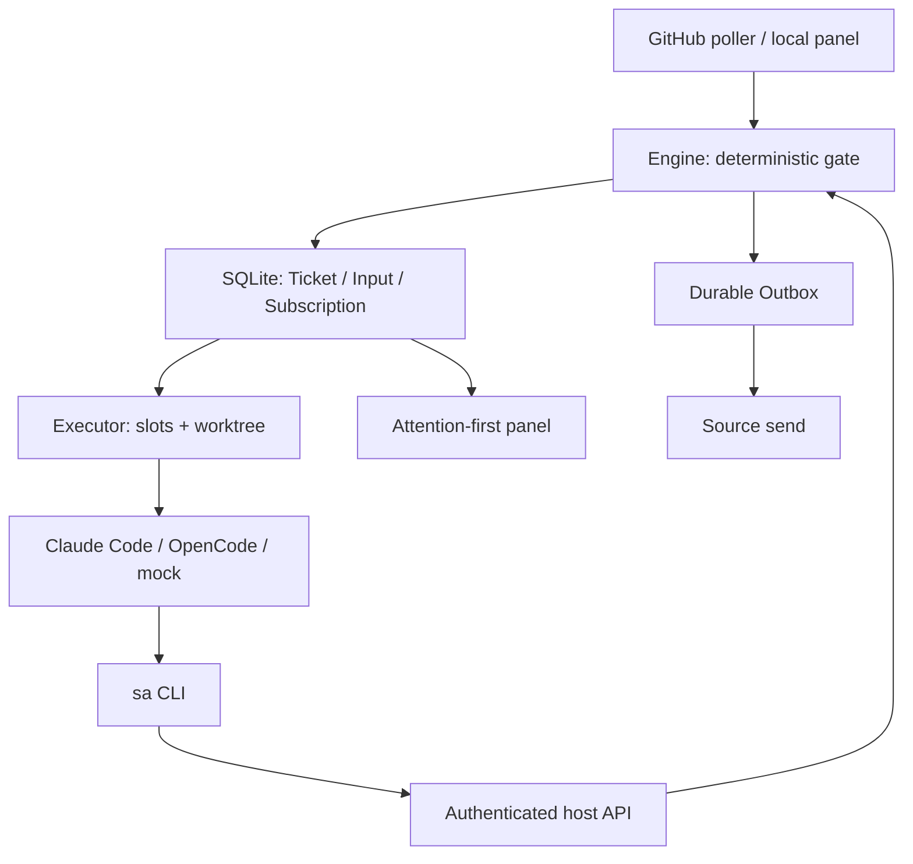

# Switch Dimension Superagent Guide를 처음부터 구현하기

이 과정은 [switch-dimension/deepseek-superagent-guide](https://github.com/switch-dimension/deepseek-superagent-guide)의 공개 README를 요구사항 명세로 삼아, 작은 호스트와 Claude Code/OpenCode Worker를 조립하는 방법을 설명합니다. 결과를 읽는 분석에서 멈추지 않고 데이터 모델, 연산 순서, 구현 파일, 실패 실험, 완료 기준으로 나눴습니다.

**확인한 원본 저장소에는 README.md와 LICENSE만 있습니다.** README §2는 자체 앱이 테스트 포함 약 2,800줄이라고 설명하지만 그 TypeScript 소스는 이 체크아웃에 없습니다. 다른 장소에 공개되었는지는 확인하지 않았습니다. 이 교재의 `src/`는 그 소스를 복원한 것이 아니라 공개 명세를 바탕으로 새로 만든 교육용 참조 구현입니다. [출처 분석](SOURCE_ANALYSIS.ko.md)에 원문 사실, 추가한 설계 선택, 미검증 범위를 구분했습니다.

이전 [DSH 프로토타입 재구현 과정](../rebuild/INDEX.ko.md)과 대상이 다릅니다. 이번에는 DSH·Cordis·LLM Router 없이 결정적 gate가 작업을 만들고, shell을 실행할 수 있는 코딩 에이전트를 Worker로 씁니다. 관찰 모드, 능동적 rule 평가, policyVersion, Feishu는 이번 가이드의 범위가 아닙니다.

## 완성했을 때의 사용자 경험

사람이 대화 공간에 요청하면 권한 검사 후 Ticket이 만들어집니다. Ticket마다 worktree·branch·session을 유지하고, 후속 댓글은 같은 작업으로 전달합니다. Worker는 `sa` CLI로 호스트에 ack/reply/report/handback을 요청합니다. 호스트가 길이·대상·상태를 검증하고 메시지를 Outbox에 저장합니다. 화면은 사람이 결정하거나 검토해야 할 작업을 먼저 보여 줍니다.

이 과정의 기본 앱은 외부 계정 없이 실행됩니다. 모의 Worker가 **실제 로컬 Git worktree에서 파일을 수정하고 커밋**합니다. Claude/OpenCode 어댑터와 GitHub 정규화·polling 로직도 포함하지만 실제 모델·GitHub 전송은 기본 앱에 연결하지 않습니다. 실제 연결은 09–10의 별도 완료 조건을 충족한 뒤 수행합니다.

## 실행

Node 24.9 이상, npm, git이 필요합니다. Node의 TypeScript 실행과 SQLite를 사용하며 runtime 의존성은 zod입니다. 이 디렉터리에서 실행합니다.

```sh
npm ci --ignore-scripts
npm run check
npm run smoke
npm start
```

`npm start`는 `http://127.0.0.1:3090`에 로컬 패널을 엽니다. 새 요청을 입력하고, 드롭다운에서 같은 작업을 선택해 후속 메시지를 보낼 수 있습니다. `fixture:block`을 새 요청으로 보내면 모의 Worker가 질문을 남깁니다. 이 작업을 선택해 `@lab-bot stop`을 보내면 영구 중단되고, 이후 멘션 없는 댓글은 그 Ticket을 재개하지 않습니다. 이 문자열은 실습 대역의 테스트 입력이며 실제 에이전트 명령어가 아닙니다.

상태는 `.state/`에 저장됩니다. Ctrl+C로 종료하면 Worker 정리와 서버 종료를 기다린 뒤 lock을 해제합니다. 강제 종료로 `host.lock`이 남으면 해당 호스트 프로세스가 종료되었는지 확인한 뒤 그 lock만 제거하세요. 자동 stale-lock 판정은 구현하지 않았습니다. 필요하면 `LAB_STATE`로 별도 실습 디렉터리, `LAB_PORT`로 다른 포트를 지정할 수 있습니다. 테스트는 OS가 배정한 임시 포트와 별도 임시 디렉터리를 씁니다.

## 빈칸 실습과 별도 정답

[단계별 실습](../practice/INDEX.ko.md)은 주변 코드와 테스트를 제공하고 핵심 로직을 직접 채우게 합니다. 01–08의 문제와 정답·해설을 분리했으며, 각 단계의 정답 프로젝트도 별도 경로에 생성할 수 있습니다.

## 처음부터 직접 작성하기

먼저 완성된 앱과 테스트를 실행해 관찰할 동작을 확인하세요. 그 다음 별도 빈 프로젝트에 package.json, package-lock.json, tsconfig.json, stage.mjs와 tests를 복사하고 `src/`를 단계별로 작성합니다. 참조 `src/`는 정답을 비교할 때 사용합니다. 아직 구현하지 않은 미래 단계의 전체 타입 검사를 통과시키려 하지 말고, 현재 단계 테스트부터 통과시키세요.

각 장은 “원문 요구사항 → 구현할 연산 → 실패시킬 실험 → 완료 기준” 순서입니다. 구현 전 테스트가 실패하는 것을 확인하고, 테스트 기대값을 바꾸지 않은 채 구현해 통과시키세요. 전체 타입 검사와 통합 smoke는 앱 조립 후 수행합니다.

|단계|설계 질문|구현·검증|
|---|---|---|
|[01 사건과 gate](lessons/01-gate.ko.md)|누가 어떤 상황에서 일을 시작·중단할 수 있나?|`model.ts`, `store.ts`, `Engine.receive`; stage 01|
|[02 Ticket 수명](lessons/02-lifecycle.ko.md)|끝난 일, 실행 중인 turn, 검토 대기는 어떻게 다른가?|`Engine.begin/finish/recover`, PR 종료; stage 02|
|[03 sa와 호스트](lessons/03-host-contract.ko.md)|Worker에게 어떤 요청만 허용할 것인가?|`sa.ts`, `Tokens`, `Engine.command`; stage 03|
|[04 Worker 교체](lessons/04-workers.ko.md)|Claude와 OpenCode의 차이를 어디서 감출 것인가?|`worker.ts`, `process.ts`; stage 04|
|[05 Source와 Outbox](lessons/05-sources.ko.md)|수집·전송 실패 후 무엇을 반복할 것인가?|`github.ts`, `outbox.ts`; stage 05|
|[06 worktree와 슬롯](lessons/06-executor.ko.md)|세션을 유지하면서 여러 작업을 어떻게 실행할 것인가?|`workspace.ts`, `executor.ts`; stage 06|
|[07 사용성과 패널](lessons/07-panel.ko.md)|사람이 지금 해야 할 일을 어떻게 보여 줄 것인가?|`http.ts`, 로컬 입력, attention 정렬; smoke|
|[08 복구와 실습 통합](lessons/08-integration.ko.md)|부팅부터 종료까지 각 자원을 누가 소유하는가?|`app.ts`, `mock-worker.ts`, 실제 Git·HTTP smoke|
|[09 실제 서비스 연결](lessons/09-deployment.ko.md)|무엇을 확인해야 sandbox 계정으로 가동할 수 있나?|실제 CLI·gh transport·배포·doctor 구현 지침|
|[10 원본 명세 완료](lessons/10-acceptance.ko.md)|어떤 증거가 있어야 README의 결과를 달성했다고 말할 수 있나?|요구사항 대응표와 live 수용 시나리오|

```sh
npm run stage -- 01
npm run stage -- 02
npm run stage -- 03
npm run stage -- 04
npm run stage -- 05
npm run stage -- 06
npm run stage -- 07
npm run stage -- 08
```

## 전체 구조



신규 요청 권한은 코드로 결정합니다. 실제 코딩 판단은 Worker가 합니다. `sa`를 통한 메시지 요청은 호스트가 검사하지만, Worker의 shell을 통한 별도 네트워크 사용까지 이 API가 봉쇄하는 것은 아닙니다. worktree와 세션 분리는 컨테이너 보안 격리와도 다릅니다.

## 검증과 출처

[VALIDATION.json](VALIDATION.json)은 개별 테스트 수, stage 실행, 실제 worktree·커밋 smoke와 파일 해시를 기록합니다. [SOURCE.json](SOURCE.json)은 분석한 원본 revision과 README/라이선스 해시, 소스 파일이 없다는 관찰을 보존합니다. [원본 대응표](REQUIREMENTS.ko.md)는 구현된 동작과 확장할 부분을 구분합니다. 원문 기반 설계·문구의 라이선스는 [UPSTREAM_LICENSE](UPSTREAM_LICENSE)에 보존했습니다.

테스트는 `--test-isolation=none`으로 실행하며 각 사례가 DB·프로세스·임시 디렉터리를 소유하고 정리합니다. 실제 provider CLI는 이 환경에 설치되지 않아 가이드에 기재된 flag의 현재 호환성이나 모델 성능을 확인하지 않았습니다. 원문의 비용·처리 시간은 작성자의 사례이며 이 구현의 측정치가 아닙니다.
