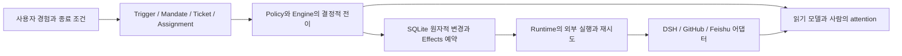

# Super-agent를 처음부터 설계하고 구현하기

이 과정은 공개 `dsh-superagent-prototype`을 결과물로 놓고, 그 결과를 만들기 위해 어떤 문제를 어떤 순서로 해결해야 하는지 역으로 구성한 한국어 구현 교재입니다. 먼저 API 키 없이 실행되는 TypeScript 시스템을 직접 만들고, 이어서 원본의 DSH·GitHub·Feishu·운영 화면으로 확장합니다. [기존 분석](../PROTOTYPE_ANALYSIS.ko.md)이 구조를 설명한다면, 이 과정은 요구사항 → 데이터 모델 → 구현 순서 → 실패 조건 → 완료 판정을 제공합니다.

독자는 TypeScript의 union/interface, Promise, SQL 트랜잭션, Git의 기본 사용법을 알고 있다고 가정합니다. Cordis나 DSH 경험은 09 단계 전까지 필요하지 않습니다. 구현 순서는 실제 DeepSeek 팀의 개발 이력을 복원한 것이 아니라, 공개 코드에서 도출한 교육용 순서입니다.

## 완성 목표를 먼저 정한다

“Master가 Worker를 호출한다”보다 구체적인 사용자 경험에서 출발합니다. 저장소에 수정 요청이 도착하면 시스템이 정책에 맞는 요청만 작업으로 만들고, 관련 후속 댓글을 그 작업에 전달하며, 결과 검토가 필요한 시점을 사람에게 보여 줍니다. 같은 댓글을 다시 받아도 작업을 중복 생성하지 않아야 하고, 사람이 중단한 작업은 자동 재개하지 않아야 합니다. 장애 이후에는 남은 실행과 전달을 복구해야 합니다.

두 완성 수준을 구분합니다. **01–08의 완성품**은 위 책임의 핵심을 작은 TypeScript 시스템으로 실험하는 참조 구현입니다. **09–10의 목표**는 실제 DSH Session, Source 수집, 정책 설정, 운영 기능을 붙여 공개 프로토타입의 기능 범위에 도달하는 것입니다. 이 교재의 LocalExecutor는 파일을 고치거나 PR을 만들지 않으며, 로컬 화면이 원본 제품과 기능적으로 동등하지 않습니다. 남은 기능을 [원본 대응표](ORIGINAL_PARITY.ko.md)에 명시했습니다.

## 먼저 완성된 작은 시스템을 실행한다

이 디렉터리에서 실행합니다. Node **24.9 이상**이 필요하며, Node의 TypeScript 타입 제거와 `node:sqlite`를 사용합니다. npm은 Node에 포함된 것을 사용합니다. Python 노트북의 uv 환경과 독립적이며 DSH SDK를 설치하지 않습니다.

```sh
npm ci --ignore-scripts
npm run check
npm run demo
npm start
```

`npm run check`는 타입 검사와 개별 테스트를 실행합니다. `npm run demo`는 임시 SQLite DB에서 요청 → 승인 → 실행 대역 → 결과 전송을 수행하고 정리합니다. 정상 결과에는 `status: open`, `execution: waiting`, `attention: review`가 나타납니다. Worker의 검토 준비 보고는 업무 종료를 의미하지 않습니다.

`npm start`는 `.state/lab.sqlite`를 사용하고 `http://127.0.0.1:8765`에 읽기 전용 패널을 엽니다. 종료는 Ctrl+C입니다. 같은 디렉터리에서 서버를 두 개 실행하지 마세요. 이 참조 구현에는 원본의 stateDir lock과 다중 프로세스 effect claim이 없습니다. 클라우드에서는 플랫폼 포트 연결을 사용합니다. 이 과정은 외부에 서비스를 게시하지 않습니다.

이 실습은 `--test-isolation=none`으로 개별 테스트를 같은 Node 프로세스에서 실행합니다. 각 테스트가 자기 Store를 만들고 종료하며 전역 상태를 공유하지 않습니다. 이 클라우드에서 기본 자식 프로세스 격리 경로가 파일 단위 통과만 표시하는 현상을 관찰해, 개별 검증문 실행을 확인할 수 있는 경로를 사용했습니다. 사례 수와 실행 근거는 [VALIDATION.json](VALIDATION.json)에 있습니다. Node의 SQLite 실험 기능 경고는 실패와 구분합니다.

## 직접 구현할 별도 작업 디렉터리

참조 `src/`는 정답을 읽는 용도로 두고 별도의 빈 프로젝트에서 구현하면 좋습니다. 아래 명령은 현재 디렉터리가 이 교재의 `rebuild`일 때 실행합니다. 이미 같은 실습 경로를 사용 중이면 새 경로를 선택하세요.

```sh
mkdir -p /tmp/my-superagent/src
cp package.json package-lock.json tsconfig.json stage.mjs /tmp/my-superagent/
cp -R tests /tmp/my-superagent/
cd /tmp/my-superagent
npm ci --ignore-scripts
npm run stage -- 01
```

처음에는 `src/source.ts`가 없어 실패하는 것이 정상입니다. 01부터 현재 단계가 요구하는 모듈을 작성하세요. 미래 단계의 파일을 미리 빈 구현으로 채울 필요는 없습니다. `npm run stage -- 01`처럼 현재 단계의 테스트만 실행하고, 전체 타입 검사와 전체 테스트는 모든 모듈을 만든 뒤 실행합니다. 앞 단계 테스트도 함께 통과해야 합니다. 테스트를 바꿔 요구사항을 줄이는 대신, 실패한 불변조건을 구현합니다.

## 단계별 경로

|단계|새로 해결하는 문제|구현 파일|완료 판정|
|---|---|---|---|
|[01 요구사항과 사건](lessons/01-domain.ko.md)|외부 댓글을 안정적인 사건으로 바꾸기|`model.ts`, `source.ts`|동일 입력 ID 안정성, 저장소 간 충돌 방지, 잘못된 입력 거부|
|[02 권한 판단](lessons/02-policy.ko.md)|모델의 제안과 host의 승인을 분리|`policy.ts`|observe, explicit, 규칙 누락·중복, 권한 없는 작성자|
|[03 승인과 작업](lessons/03-admission.ko.md)|승인 사실과 실행 예약을 함께 저장|`store.ts`, `engine.ts` 기초|중복 없는 Ticket, 오래된 판단 거부, 트랜잭션 롤백|
|[04 후속 입력](lessons/04-routing.ko.md)|문맥 전달과 새 업무 평가를 구분|Engine Intake·Subscription|소유 후속 입력, context-only, 다중 Thread 중복|
|[05 영속 Effects](lessons/05-effects.ko.md)|장애 후에도 실행 의도가 남게 만들기|Store Effects|generation 보호, backoff, DB 재열기, schema 거부|
|[06 실행과 재개](lessons/06-runtime.ko.md)|Ticket과 실행 시도의 수명을 구분|`runtime.ts`, Engine 수명주기|늦은 보고, 사람 stop, 현재 정책 재검증, unread 복구|
|[07 외부 연결](lessons/07-adapters.ko.md)|전송 결과 불명확성과 cursor 유실 다루기|Source·Executor·Channel 포트|cursor 원자성, 응답 유실, 제한된 재시도, pause|
|[08 사용성과 화면](lessons/08-views.ko.md)|사람이 판단할 상태를 보여 주기|`views.ts`, `demo.ts`, `server.ts`|접근 범위, 페이지 복원, HTML escaping, HTTP smoke|
|[09 DSH로 교체](lessons/09-dsh.ko.md)|대역을 실제 세션과 모델 도구로 교체|원본 Sessions·Assessor·DshExecutor|원본 포트와 callback을 연결하고 세션 수명 검증|
|[10 원본 범위 완성](lessons/10-production.ko.md)|지속 수집·정책 운영·복구를 완성|원본 Source·Passes·Setup·Panel|원본 대응표의 미구현 항목을 차례로 닫기|

01–08은 `npm run stage -- 01`부터 `08`까지 독립적으로 실행할 수 있습니다. 09–10은 원본 코드와 테스트를 따라 구현하는 확장 과정이며, 이 축소 구현에 해당 기능이 이미 들어 있다는 의미가 아닙니다.

## 설계 선택의 연결



호출 관계를 복잡하게 만들기 전에 상태의 소유자를 정합니다. Engine은 업무 상태를 변경하고, Runtime은 예약된 I/O를 수행하며, 어댑터는 외부 결과를 Engine에 사실로 보고합니다. 화면은 상태를 읽어 보여 줍니다. 이 교재에서는 이해를 위해 Engine이 Store에 직접 의존하지만, 09에서 원본의 좁은 Repositories/Executor/Assessor 포트로 바꿉니다.

## 검증 방법과 근거

각 장은 구현 전 질문, 데이터·연산 설계, 구현 순서, 실행 명령, 실패 실험, 원본 코드 대응을 포함합니다. 일부러 실패를 주입하는 테스트는 정상 경로만 통과하는 구현을 구분하기 위한 것입니다. 실시간 모델의 판단 정확도와 외부 서비스의 운영 품질은 이 테스트로 증명하지 않습니다.

원본 분석 revision과 출처 파일 해시는 [기존 수집 근거](../sources/prototype-evidence.json)를 사용합니다. 원본 링크는 이동 가능한 `main`을 가리키므로 정확히 비교하려면 그 JSON의 revision으로 체크아웃하세요. 원본의 전체 테스트에서 관찰한 Feishu 상태 실패 1건은 [분석 보고서](../PROTOTYPE_ANALYSIS.ko.md)에 있으며, 이 과정의 테스트 통과와 별개입니다.
